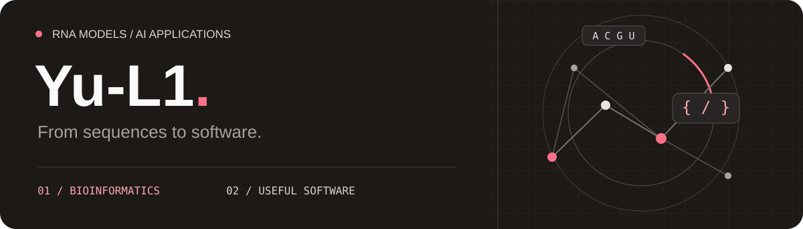

**RNA 序列建模 · AI 应用 · 全栈开发**

[在线预测](https://xiaof-xy--rlmf.modal.run/) &nbsp; · &nbsp; [模型权重](https://huggingface.co/Yu-star/RLMF-m6APred) &nbsp; · &nbsp; [全部项目](https://github.com/Yu-L1?tab=repositories)

 

## 🧬 模型与应用

<table>
  <tr>
    <td>
      FEATURED PROJECT
      <h3><a href="https://github.com/Yu-L1/RLMF-m6APred">RLMF-m6APred</a></h3>
      
RNA m6A 位点预测。面向人、小鼠和大鼠的 11 组物种／组织数据，提供模型权重、独立测试集推理代码与在线预测。

      
<code>PyTorch</code> <code>RNA language models</code> <code>LoRA</code>

      
<a href="https://xiaof-xy--rlmf.modal.run/">在线体验 ↗</a> &nbsp; · &nbsp; <a href="https://github.com/Yu-L1/RLMF-m6APred">源代码</a> &nbsp; · &nbsp; <a href="https://huggingface.co/Yu-star/RLMF-m6APred">Hugging Face</a>

    </td>
  </tr>
</table>

 

## ⚡ AI 开发与创作

<table>
  <tr>
    <td width="50%" valign="top">
      BUILD WITH AI
      <h3><a href="https://github.com/Yu-L1/code-generate">Code Generate</a></h3>
      
从一句需求生成网站。支持对话式迭代、实时预览、部署与源码导出。

      
<code>Java</code> <code>Spring Boot</code> <code>Vue</code> <code>LangChain4j</code>

      
<a href="https://github.com/Yu-L1/code-generate">查看项目 ↗</a>

    </td>
    <td width="50%" valign="top">
      CREATE WITH AGENTS
      <h3>AI 图文创作</h3>
      
从选题、标题、大纲到正文和配图，多智能体协作，支持分阶段编辑与流式输出。

      
<code>Spring AI Alibaba</code> <code>FastAPI</code> <code>Vue</code> <code>SSE</code>

      
<a href="https://github.com/Yu-L1/passage-java">Java 版 ↗</a> &nbsp; · &nbsp; <a href="https://github.com/Yu-L1/passage-python">Python 版 ↗</a>

    </td>
  </tr>
</table>

 

## 🛠 项目工具箱

**Modeling** &nbsp; `Python` `PyTorch` `Transformers` `PEFT`

**Backend** &nbsp; `Java` `Spring Boot` `FastAPI` `MySQL` `Redis`

**Frontend** &nbsp; `Vue` `TypeScript`
